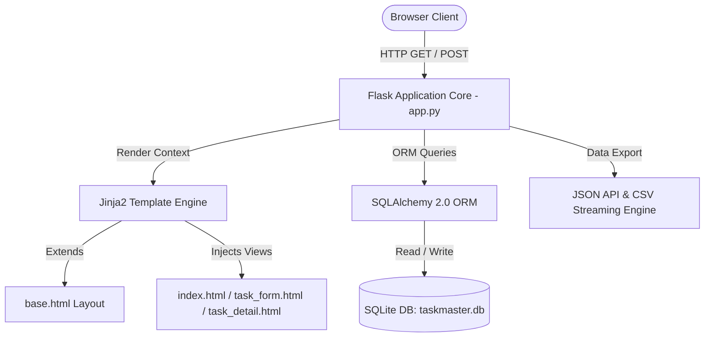

# ⚡ TaskMaster Pro — Flask Mini Project (Interview Favorite)

A full-stack Python web application designed to demonstrate backend fundamentals, clean software architecture, RESTful routing, and modern UI design. Built with **Flask 3.1**, **SQLAlchemy ORM**, **SQLite**, and **Bootstrap 5.3**.

---

## 🎯 Project Objectives & Backend Fundamentals

This project demonstrates core backend competencies commonly assessed in software engineering technical interviews:
- **Flask Routing & Application Lifecycle**: Modular routing, application factory pattern, parameterized dynamic routes (`<int:id>`), HTTP methods segregation, custom 404/500 error handlers.
- **Jinja2 Template Inheritance**: DRY frontend architecture with `base.html`, dynamic navigation states, context variables, loops, filters, and conditional badge rendering.
- **Form Handling (GET & POST)**:
  - **GET**: Query parameter processing for search keyword filters, categorical dropdowns, and multi-field sorting (`request.args`).
  - **POST**: Form submissions (`request.form`), client and server-side input validation, CSRF-safe state changes, and flash message dispatching.
- **Data Persistence & ORM**: SQLite relational storage using modern SQLAlchemy 2.0 / Flask-SQLAlchemy syntax (`db.select`, `db.session`, entity lifecycle).
- **RESTful Best Practices**: Safe HTTP state mutations (e.g., performing Deletion and Status Toggles via `POST` rather than `GET`).
- **Clean UI & UX**: Modern, responsive Bootstrap 5 interface with KPI summary analytics, glassmorphic cards, and auto-dismiss alerts.

---

## 🏗️ Architecture & Component Overview



---

## 🚀 Key Features

1. **Dashboard & KPI Analytics**: Real-time counters for Total, In Progress, Completed, and Overdue tasks with a visual progress bar.
2. **Search, Filter & Sort (GET)**: Search by title/description, filter by Status (Pending, In Progress, Completed), Priority (Urgent, High, Medium, Low), and Category, with flexible sorting.
3. **Full CRUD Lifecycle**:
   - **Create**: Input validation, custom categories, date selection, flash feedback.
   - **Read**: Dynamic list view and comprehensive task detail view (`/tasks/<id>`).
   - **Update**: Pre-populated edit form, inline status cycling (`Pending` &rarr; `In Progress` &rarr; `Completed`).
   - **Delete**: Safe POST deletion with browser confirmation dialog, plus bulk cleanup for completed tasks.
4. **Data Portability**: Built-in RESTful JSON API endpoint (`/api/tasks`) and 1-click CSV export (`/export/csv`).
5. **Pre-Seeded Sample Data**: Automatically populates realistic initial tasks on first launch for instant evaluation.

---

## 📂 Project Directory Structure

```text
flask_mini_project/
├── app.py              # Flask app factory, route controllers, and business logic
├── models.py           # SQLAlchemy Task model and business logic properties
├── test_app.py         # Pytest test suite covering all CRUD endpoints and routes
├── requirements.txt    # Production & development dependencies
├── wsgi.py             # WSGI entry point for production deployments (Gunicorn)
├── Procfile            # Deployment descriptor for Render / Heroku
├── .gitignore          # Git exclusions for Python cache, virtual environments, DB
├── README.md           # Documentation, setup guide, and interview Q&A
├── static/
│   ├── css/
│   │   └── style.css   # Custom styling, color palette, badges, and card animations
│   └── js/
│       └── main.js     # Auto-dismiss alerts, tooltips, character counter
└── templates/
    ├── base.html       # Base layout with navbar, alerts container, and footer
    ├── index.html      # Dashboard, analytics cards, search/filter, and task directory
    ├── task_form.html  # Unified reusable form for Create and Edit operations
    ├── task_detail.html# Individual task inspection view with metadata
    └── 404.html        # Custom 404/500 error page
```

---

## 🛠️ Installation & Local Setup

### 1. Prerequisites
- Python 3.10+ installed
- Git installed

### 2. Clone or Navigate to the Directory
```bash
cd c:/Python_project/flask_mini_project
```

### 3. Create and Activate a Virtual Environment
```bash
# Windows
python -m venv venv
.\venv\Scripts\activate

# macOS / Linux
python3 -m venv venv
source venv/bin/activate
```

### 4. Install Dependencies
```bash
pip install -r requirements.txt
```

### 5. Run the Application
```bash
python app.py
```
Open your browser and visit: **`http://127.0.0.1:5000`**

### 6. Run Automated Tests
```bash
pytest test_app.py -v
```

---

## 🌐 API & Route Reference

| Method | Route | Description |
|---|---|---|
| `GET` | `/` | Dashboard, analytics KPIs, search & filter toolbar, task listing |
| `GET` | `/tasks/new` | Renders task creation form |
| `POST` | `/tasks/new` | Validates and creates a new task |
| `GET` | `/tasks/<id>` | Displays individual task details and metadata |
| `GET` | `/tasks/<id>/edit` | Renders pre-populated edit form |
| `POST` | `/tasks/<id>/edit` | Validates and persists task updates |
| `POST` | `/tasks/<id>/toggle`| Cycles status: `Pending` &rarr; `In Progress` &rarr; `Completed` |
| `POST` | `/tasks/<id>/delete`| Safely deletes task |
| `POST` | `/tasks/clear-completed` | Bulk deletes all completed tasks |
| `GET` | `/api/tasks` | Returns all tasks serialized as JSON |
| `GET` | `/export/csv` | Streams downloadable CSV of all tasks |

---

## 🚢 GitHub Repository Setup Instructions

To push this project to your own GitHub account:

```bash
# 1. Initialize Git in the project directory
cd c:/Python_project/flask_mini_project
git init

# 2. Stage all files
git add .

# 3. Create initial commit
git commit -m "Initial commit: Flask Mini Project with CRUD, Bootstrap 5, and Tests"

# 4. Link to your new GitHub repository (replace with your repo URL)
git branch -M main
git remote add origin https://github.com/<your-username>/flask-taskmaster-pro.git

# 5. Push to GitHub
git push -u origin main
```

---

## ☁️ Live Demo Deployment Guide (Free Hosting)

### Option A: Render.com (Recommended — 3 Minutes)
1. Push this project to GitHub.
2. Sign in to [Render](https://render.com) and click **New + > Web Service**.
3. Connect your GitHub repository.
4. Set the following configuration:
   - **Environment**: Python 3
   - **Build Command**: `pip install -r requirements.txt`
   - **Start Command**: `gunicorn wsgi:app`
5. Click **Create Web Service**. Your live URL will be ready in under 2 minutes!

### Option B: PythonAnywhere (Free & No Credit Card)
1. Create a free account at [PythonAnywhere](https://www.pythonanywhere.com/).
2. In the **Web** tab, create a new manual Flask app with Python 3.10+.
3. Open a Bash console, clone your repo, and install requirements.
4. Point your WSGI configuration file to:
   ```python
   import sys
   path = '/home/<username>/flask_mini_project'
   if path not in sys.path:
       sys.path.append(path)
   from wsgi import app as application
   ```
5. Reload your web app to view the live demo.

---

## 💡 Backend Technical Interview Q&A Cheatsheet

### Q1: Why use `POST` instead of `GET` for deleting tasks or changing state?
> **Answer**: `GET` requests must be **idempotent and safe** according to RFC 7231 specifications. They can be cached by browsers, prefetched by search engines, or bookmarked. If deletion used `GET`, a web crawler following links could unintentionally wipe out data. `POST` signals state modification and protects against accidental execution.

### Q2: What is the purpose of Jinja2 Template Inheritance (`base.html`)?
> **Answer**: It enforces the **Don't Repeat Yourself (DRY)** principle. Common HTML boilerplate (HTML headers, CDN stylesheets, navigation bar, flash notification banners, and footer) lives in a single master layout. Child templates extend `base.html` and only define page-specific blocks (``).

### Q3: How do Flask Flash messages work internally?
> **Answer**: Flask flash messages store temporary feedback (e.g. "Task created successfully") in the client's cryptographically signed session cookie (using `SECRET_KEY`). Once rendered in the next request via `get_flashed_messages()`, the messages are consumed and removed from the session.

### Q4: Why use an ORM (SQLAlchemy) over raw SQL queries?
> **Answer**:
> 1. **SQL Injection Prevention**: SQLAlchemy uses parameterized queries by default.
> 2. **Object-Relational Mapping**: Database rows are treated as Python objects with type hints, custom properties, and methods.
> 3. **Database Portability**: Code can seamlessly switch from SQLite in local development to PostgreSQL in production without rewriting SQL dialect queries.

---

## 📜 License
This project is open-source and available under the [MIT License](LICENSE).
